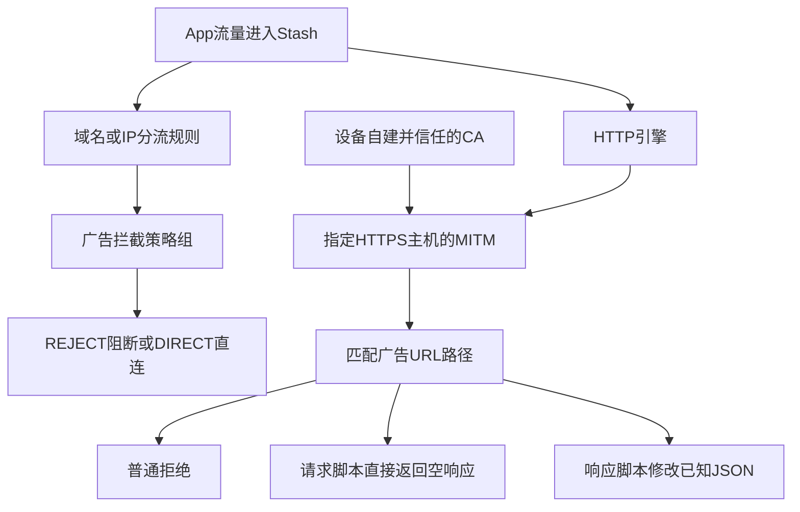

# Stash去广告方案：完整技术说明与排查规格

整理日期：2026-10-20。审阅基线：`d8ea21e`；配置、规则、40个专项模块和12份JS均直接读取。本文盘点已写入代码的功能，不将文件存在、模拟通过或证书受信任记为真实广告已去除。用户此前已确认HTTP/MITM开启且自建证书完全信任，也反馈过淘宝、微博等开屏仍在；目前没有逐款设备验收通过记录。自动签到继续暂停。

本文可独立交给调查者审阅。第1—10部分说明当前方案；第11部分提供从真实公共主配置提取的全部广告规则、HTTP处理声明及脚本地址；第12—14部分记录脚本对运行环境的具体假设、手机端手工接入与源码校验值；第15部分附上12份运行JS完整原文。配置片段是供核对的技术材料，不是一份可直接导入的完整配置。本次补全只展开已有方案，不调整实际规则或JS，也没有诊断出唯一失败根因。

**1. 当前实际装了什么**

推荐入口是 [config/stash.yaml](../config/stash.yaml)。它由同一套源文件生成，包含基础域名包和全部40款候选专项；机场URL只作为节点来源，私人参数及CA私钥保存在设备端。

这里的“默认”描述仓库文件。手机可能保存不同的策略组选择、HTTP设置或额外覆写；下文按规则模式、流量确实进入Stash解释，以最终生效配置为准。

| 项目 | 当前代码数量与含义 |
|---|---|
| 主配置总分流规则 | 5,314条，主要还包含国内、软件和地区相关分流，不能全部计为去广告规则 |
| 默认广告路由 | 49条＝38条基础域名规则＋11条App专用主机规则，目标均为“广告拦截”组 |
| 可选扩展包 | 38,066条；默认一体化入口没有载入，适用方式见第7部分 |
| 独立文件 | 40个App专项＋1个扩展包；文件独立不等于一体化配置里有40个开关 |
| 普通URL拒绝 | 16条`http.rewrite`，涉及14个App |
| 请求阶段脚本 | 18个处理项，涉及13个App，直接构造空JSON或空正文响应 |
| 响应阶段脚本 | 10个处理项，涉及10个App，修改已知JSON字段 |
| JS资源 | 12份＝10份响应修改脚本＋微博脚本＋共享空响应脚本；多个处理项可复用一份JS |
| MITM主机 | 41个去重后的精确主机；不含全域通配解密 |

同一App可以同时使用域名、URL拒绝和脚本，因此各技术涉及的App数量不能直接相加。完整40款在第4部分。

**2. 整体工作关系**



这是职责关系图；域名/IP层和HTTP层是两套独立配置。域名阻断不需要证书；本文所列专项URL均匹配HTTPS，路径处理需要HTTP引擎、可成功解密的MITM及匹配的主机。证书本身不识别或删除广告。

本项目使用阿里/腾讯DoH作普通解析，没有部署DNS返回黑洞地址、浏览器内容过滤插件、界面自动点击或iOS进程注入方案。国内业务选DIRECT也不等于关闭Stash的广告处理；是否能处理仍取决于流量是否实际进入Stash及HTTP设置。

**3. 四种已经实现的处理方式**

| 方式 | 具体实现 | 适用情况 | 主要限制 |
|---|---|---|---|
| 域名/IP阻断 | 域名、后缀、关键词或IP段命中后交给“广告拦截”策略组，文件默认REJECT | 独立广告服务器、第三方广告SDK | 广告与正常业务共用主机时不能整域拦截；DIRECT表示直接连接该主机，可达性另论 |
| URL路径拒绝 | `http.rewrite`的`正则 - reject`，只匹配专用广告路径 | 开屏接口、素材或独立广告端点 | 请求失败不保证App跳过广告，可能重试、空白或保留倒计时；联通2条原图片响应尚未等价实现 |
| 请求脚本空响应 | `type: request`、`require-body: false`，用`$done({response: ...})`直接构造200与`{}`或空正文 | 来源明确要求空JSON/空200的广告端点 | 不等待原服务器，不校验原响应结构；如果App不接受空结果或换接口，仍可能无效 |
| JSON响应修改 | `type: response`、`require-body: true`，解析服务器JSON，只改已识别广告字段，再调用`$done({body: ...})` | 广告和正常内容同处一个响应、不能直接拒绝整个接口 | 依赖当前路径和JSON结构；缓存、接口改版、非JSON、Protobuf或其他协议可能不命中 |

基础38条由27条DOMAIN-SUFFIX、8条DOMAIN、3条DOMAIN-KEYWORD组成，涉及穿山甲/Pangle、百度广告、广点通、Google广告、快手及Unity等已列明主机。不能据此认定所有国产App都使用这些SDK。完整基础规则在文末。

基础与扩展都可能拦到用户主动观看的奖励广告，依赖观看广告才能领券的流程无法保证；普通领券接口没有被直接整域封禁，也不等于所有关联流程已经在手机验证。

扩展包的类型是：23,753条DOMAIN、13,939条DOMAIN-SUFFIX、187条DOMAIN-KEYWORD、186条IPv4段、1条IPv6段，共38,066条。它比基础包更广，可能涉及统计、追踪及奖励广告，更多不等于对每款App更有效。

**4. 已有40款专项逐项盘点**

下表的“已实现”均指代码范围，全部仍待真实设备逐款验收。文件链接中可查看完整正则、主机和调用脚本，不需要导入另一套项目。

| 序号 | App | 当前手段及处理项数 | 仅处理范围 | 模块源码 |
|---|---|---|---|---|
| 1 | 58同城 | URL拒绝1 | 仅 home/advertising 和 appadv；保留职位、联系与发布 | [58tongcheng](../modules/ads/58tongcheng.stoverride) |
| 2 | 阿里云盘 | JSON响应修改1 | 仅 onboard_list 的4种推广banner；不宣称阿里云盘开屏或全界面去广告 | [alipan](../modules/ads/alipan.stoverride) |
| 3 | 高德地图 | 域名2；URL拒绝1；请求空响应1 | 两个独立启动广告接口及 optimus 广告域名；保留路线、定位和普通地图图片 | [amap](../modules/ads/amap.stoverride) |
| 4 | 百度网盘 | URL拒绝1 | 网盘独立 ad/adx 广告接口；不拦福利、会员、下载、分享 | [baidu-netdisk](../modules/ads/baidu-netdisk.stoverride) |
| 5 | 哔哩哔哩 | JSON响应修改1 | JSON开屏与推荐流的明确广告卡片；不含Protobuf、视频贴片或UP主植入 | [bilibili](../modules/ads/bilibili.stoverride) |
| 6 | 菜鸟 | JSON响应修改1 | 仅 ads.show 的明确 adItemDetail 广告项；不包含 mshow 或完整首页净化 | [cainiao](../modules/ads/cainiao.stoverride) |
| 7 | 中国移动 | URL拒绝1 | 仅 explorePage/getAdverList 候选广告接口；没有完整启动广告去除证据 | [cmcc](../modules/ads/cmcc.stoverride) |
| 8 | 携程旅行 | 域名1 | 仅 ma-adx 主机的广告/统计请求；没有完整开屏去除证据 | [ctrip](../modules/ads/ctrip.stoverride) |
| 9 | 大麦 | 请求空响应1 | 专用 home.welcome 开屏；不屏蔽 HTTPDNS、票务或下单 | [damai](../modules/ads/damai.stoverride) |
| 10 | 大众点评 | URL拒绝1 | 仅 loadsplashconfig 开屏配置；不删普通首页、优惠或评价 | [dianping](../modules/ads/dianping.stoverride) |
| 11 | 东方财富 | 域名1 | 仅 emdcadvertise 独立广告主机；不代表行情页面全部推广 | [eastmoney](../modules/ads/eastmoney.stoverride) |
| 12 | 华住会 | URL拒绝1 | 仅 getAppStartPage 开屏；保留酒店优惠、新客权益、更新和预订 | [huazhu](../modules/ads/huazhu.stoverride) |
| 13 | 京东金融 | 域名2 | 仅 bdsp-x/dsp-x 广告主机候选；不包含金融网关或完整开屏 | [jingdong-finance](../modules/ads/jingdong-finance.stoverride) |
| 14 | 京东 | JSON响应修改1 | 仅 URL 中 functionId=start 的历史开屏展示字段；不包含全部京东广告 | [jingdong](../modules/ads/jingdong.stoverride) |
| 15 | 肯德基 | URL拒绝1 | 仅 advertisement 路径广告素材候选；不包含完整开屏控制、菜单或优惠券 | [kfc](../modules/ads/kfc.stoverride) |
| 16 | 猎聘 | 请求空响应1 | 明确命名的 live.get-ad-cards；不拦职位推荐或投递 | [liepin](../modules/ads/liepin.stoverride) |
| 17 | 瑞幸咖啡 | JSON响应修改1 | 仅 sys/app/adposNew 独立广告响应；保留点单、商品与优惠券 | [luckin](../modules/ads/luckin.stoverride) |
| 18 | 脉脉 | 请求空响应2 | 仅 adshow；保留礼物、消息和普通推荐 | [maimai](../modules/ads/maimai.stoverride) |
| 19 | 麦当劳 | 请求空响应1 | 专用 portal/home/splash；保留点餐、支付、领券 | [mcdonalds](../modules/ads/mcdonalds.stoverride) |
| 20 | 美团 | JSON响应修改1 | 仅美团外卖 wmapi 的 loadInfo.startpicture.ad/mk；不代表美团主App开屏 | [meituan](../modules/ads/meituan.stoverride) |
| 21 | 米家 | 请求空响应1 | 仅 openingBanner 两个端点；保留设备控制、普通推荐和自动化 | [mijia](../modules/ads/mijia.stoverride) |
| 22 | 网易邮箱大师 | URL拒绝1；请求空响应1 | mmad 素材和 searchMultiAds/showAds；保留邮件、搜索和同步 | [netease-mail](../modules/ads/netease-mail.stoverride) |
| 23 | 网易云音乐 | 请求空响应3 | 仅3个精确主机的 api/ad 或 eapi/ad 路径候选；不解密 EAPI 正文 | [netease-music](../modules/ads/netease-music.stoverride) |
| 24 | 拼多多 | URL拒绝2 | 仅 cappuccino/splash；保留首页、买菜、红包和领券 | [pinduoduo](../modules/ads/pinduoduo.stoverride) |
| 25 | 铁路12306 | 域名1 | 仅 ad.12306.cn 独立广告主机；不保证取消客户端缓存开屏 | [railway12306](../modules/ads/railway12306.stoverride) |
| 26 | 淘宝 | JSON响应修改1 | 专用splash API的taobao-splash广告条目；不含普通首页、商品视频及独立天猫App | [taobao](../modules/ads/taobao.stoverride) |
| 27 | 淘票票 | URL拒绝1 | 仅 queryloadingbanner 启动广告；保留普通活动、选座和购票 | [taopiaopiao](../modules/ads/taopiaopiao.stoverride) |
| 28 | 百度贴吧 | JSON响应修改1 | getSplashAd开屏JSON；不含帖子、直播或会员 | [tieba](../modules/ads/tieba.stoverride) |
| 29 | UC浏览器 | 域名2 | 仅 ads.uc.cn、adslot.uc.cn 独立广告主机；不包含网页同域广告 | [uc](../modules/ads/uc.stoverride) |
| 30 | 航旅纵横 | URL拒绝1 | 仅 fs/advert/polite 广告素材候选；不包含开屏展示控制或航班业务 | [umetrip](../modules/ads/umetrip.stoverride) |
| 31 | 中国联通 | URL拒绝2 | 专用启动/广告接口；保留 accountListData、客户端配置和缴费 | [unicom](../modules/ads/unicom.stoverride) |
| 32 | 云闪付 | 域名2 | 仅 ads.95516.com 和 ads.cup.com.cn 广告请求；不代表云闪付全界面去广告 | [unionpay](../modules/ads/unionpay.stoverride) |
| 33 | 微信 | JSON响应修改1 | 仅历史公众号 getappmsgad 的广告字段；不包含朋友圈、视频号或聊天 | [wechat-articles](../modules/ads/wechat-articles.stoverride) |
| 34 | 微博 | 请求空响应2 | 两个实时/预加载开屏接口；不含时间线、国际版全部接口或消息 | [weibo](../modules/ads/weibo.stoverride) |
| 35 | WPS Office | URL拒绝1；请求空响应1 | 仅广告统计请求与 feeds_ad 素材；没有完整开屏或文档内广告去除证据 | [wps](../modules/ads/wps.stoverride) |
| 36 | 下厨房 | URL拒绝1 | 仅 vN/ad/ 专用广告路径；保留菜谱、购物和内容图片 | [xiachufang](../modules/ads/xiachufang.stoverride) |
| 37 | 闲鱼 | 请求空响应1 | 仅 idlecommerce.splash.ads；保留聊天、交易、闲鱼币和搜索 | [xianyu](../modules/ads/xianyu.stoverride) |
| 38 | 小红书 | JSON响应修改1 | splash_config中已知广告展示时间；不含笔记信息流、下载或水印 | [xiaohongshu](../modules/ads/xiaohongshu.stoverride) |
| 39 | 小宇宙 | 请求空响应1 | 仅 flash 开屏；保留节目推荐、AI总结、搜索和播客音频 | [xiaoyuzhou](../modules/ads/xiaoyuzhou.stoverride) |
| 40 | 知乎 | 请求空响应2 | 仅开屏、顶部横幅与 ad-style-service 候选；不包含全部回答和信息流广告 | [zhihu](../modules/ads/zhihu.stoverride) |

**5. 脚本到底改了哪些内容**

| 脚本 | 已实现的具体修改 | 刻意保留的边界 |
|---|---|---|
| [bilibili.js](../scripts/ads/bilibili.js) | 开屏成功JSON删除`data.show`；推荐流删除列明的广告卡片，并只过滤banner中的广告子项 | 不删普通推荐、非广告banner或正常视频；不处理Protobuf、视频贴片或UP主植入 |
| [tieba.js](../scripts/ads/tieba.js) | `getSplashAd`成功响应改成无广告错误码`2230209`，`data`置空 | 只限这个广告接口，不处理帖子、直播或账号权益 |
| [taobao.js](../scripts/ads/taobao.js) | 只改`splash_home_base`中的`taobao-splash`记录：展示次数/等待归零、冷热启动关闭、展示窗口推迟到2090年、图片与视频地址清空；补齐缺省控制字段并保留已知标量类型 | 保留MTOP外层结果、普通首页、商品、正常视频及券；不是淘宝全界面或独立天猫专项 |
| [xiaohongshu.js](../scripts/ads/xiaohongshu.js) | 只将`splash_config`中`ads_groups`及子广告的已知起止时间推迟到2090年，兼容数字/数字字符串并补齐缺省值 | 不处理笔记、信息流、下载、水印或消息；不删除已缓存广告文件 |
| [alipan.js](../scripts/ads/alipan.js) | `onboard_list`过滤`backup_top_banner`、`home_top_banner`、`resource_top_banner`、`video_top_banner`四类锚点 | 保留备份、账号、新闻等其他卡片，不宣称开屏全净化 |
| [cainiao.js](../scripts/ads/cainiao.js) | 在`ads.show`结果中删除`materialContentMapper.adItemDetail`广告项 | 保留其他卡片、包裹、积分和正常领券；不含`mshow`等其他接口 |
| [jingdong.js](../scripts/ads/jingdong.js) | 只限唯一`functionId=start`：已有`showTimes`、`time`、`showTimesDaily`显示字段归零 | 不改商品、订单或券；不代表所有新版京东开屏结构 |
| [meituan.js](../scripts/ads/meituan.js) | `wmapi`的`loadInfo`中，仅清空`data.startpicture.ad`与`mk`广告数组 | 美团外卖端点，不代表美团主App全部开屏；其他启动字段保留 |
| [luckin.js](../scripts/ads/luckin.js) | 专用`adposNew`广告接口的已知成功JSON缩减为`status: SUCCESS` | 不处理点单、支付、商品或券接口；不把原来的失败响应伪装为成功 |
| [wechat-articles.js](../scripts/ads/wechat-articles.js) | 历史公众号`getappmsgad`中，`advertisement_info`清空，`advertisement_num`归零 | 保留文章和appid；不处理聊天、朋友圈或视频号 |
| [weibo.js](../scripts/ads/weibo.js) | 新配置在两个开屏请求阶段直接返回200与`{}`；也兼容旧response配置的空JSON正文修改 | 不挂整个微博API，不处理时间线、消息、会员或国际版全部广告 |
| [empty-response.js](../scripts/ads/empty-response.js) | 按审核目录匹配16个处理项，返回200与空JSON/空正文；通过一个公共JS供12款App复用 | 不读取请求正文、不等待服务器、不操作业务账号；不匹配时放行 |

共享空响应的当前分配如下；微博的2个请求处理项使用自己的脚本，所以请求处理项合计为18：

| 返回类型 | App |
|---|---|
| 200＋空JSON `{}` | 高德、脉脉、猎聘、米家、网易云音乐、闲鱼、小宇宙、知乎；另有微博自己的2个接口 |
| 200＋空正文 | 大麦、麦当劳、网易邮箱大师素材、WPS广告素材 |

原来源的reject-dict/reject-200没有直接塞进Stash：这里已经改成原生request脚本。联通来源中的2条reject-img仍是普通reject，尚未提供等价空图片。

所有28个脚本处理项设置5秒超时；10份JSON响应脚本有正文字符串长度限制（阈值为1,048,576或2,097,152个JS字符串码元，非精确网络字节数）。多数脚本限制GET/POST，B站只接受GET；贴吧依靠精确接口与状态/结构判断，没有额外的方法限制。未知结构、非JSON、已识别失败响应或脚本异常通常返回空修改对象以保留原响应。这个保护不等于TLS解密失败、原生超时、普通reject或空响应策略都会自动放行。

**6. 开关、证书和单App模块的真实关系**

| 操作或状态 | 域名/IP规则 | URL拒绝、请求脚本、响应脚本 |
|---|---|---|
| “广告拦截”选REJECT | 阻断命中的广告域名/IP | 不改变HTTP层的设置 |
| “广告拦截”选DIRECT | 命中的域名/IP改为直接连接 | 仍可能继续处理HTTPS广告路径 |
| 本机域名白名单 | 可优先放行指定主机 | 不能取消同主机的HTTP路径处理 |
| 关闭HTTP引擎或不进行相关HTTPS MITM | 域名/IP层仍可工作 | 相应HTTPS路径无法按这套方案处理；需核对实际运行状态和连接重建 |
| 安装并信任本人CA | 不改变域名规则 | 是MITM解密的条件之一，还要开启引擎、配置主机并命中路径 |
| 在按需分层模式关闭某App覆写 | 撤销该覆写提供的规则，但通用包可能仍覆盖同一主机 | 撤销该覆写的处理；其他配置层不能有同款处理副本 |
| 在一体化模式停用额外添加的同款单App覆写 | 主配置内置的域名规则仍在 | 主配置内置处理仍在，不能据此当作已关闭该App专项 |
| 断开Stash VPN、流量不再进入Stash | 本项目不能继续拦截 | 本项目不能继续处理；以实际VPN/连接状态为准 |

**当前一体化主配置没有逐款App启停的策略组或参数。** 40款专项在生成时已组装；独立文件名里的“可选”和目录中`default_enabled: false`描述的是不额外自动安装单独覆写，不能推断一体化入口未包含它们。要逐款开关，应使用既有的core分层方式，或本地包基础主配置配单App文件；不叠加同款模块。

CA由用户在设备生成并信任，本仓库没有提供或上传证书私钥。虽然脚本只按广告路径修改，MITM解密能力的范围仍是下面41个整个精确主机；其中部分是业务共享网关，并非每个主机只承载广告。

```text
acs.m.goofish.com
acs.m.taobao.com
amap-aos-info-nogw.amap.com
api-ac.liepin.com
api.m.jd.com
api.mcd.cn
api.pinduoduo.com
api.xiachufang.com
api.xiaoyuzhoufm.com
api.yangkeduo.com
api.zhihu.com
app.58.com
app.bilibili.com
appapi.huazhu.com
appconf.mail.163.com
bootpreload.uve.weibo.com
bootrealtime.uve.weibo.com
capi.lkcoffee.com
client.app.coc.10086.cn
client.mail.163.com
cn-acs.m.cainiao.com
edith.xiaohongshu.com
guide-acs.m.taobao.com
h3.open.taou.com
home.mi.com
interface.music.163.com
interface3.music.163.com
ios.wps.cn
ipv4.music.163.com
m.client.10010.com
m5.amap.com
mapi.dianping.com
member.alipan.com
mobile-pic.cache.iciba.com
mp.weixin.qq.com
open.taou.com
oss.umetrip.com
pan.baidu.com
res.kfc.com.cn
tiebac.baidu.com
wmapi.meituan.com
```

没有`*`泛化解密，没有银行/支付主域的整域解密，也没有通过关闭TLS校验解决兼容性。证书固定、HTTP/3、非443端口和应用私有协议的覆盖未完成，不能承诺这些流量一定进入脚本。

**7. 三种配置载体，以及扩展包为何可能加了也没作用**

| 载体 | 公共规则与JS放在哪里 | 逐App开关 | 扩展包的正确适用方式 |
|---|---|---|---|
| 推荐一体化`config/stash.yaml` | 规则已展开内嵌；12份JS通过本仓库稳定URL获取 | 当前没有；40款已内置 | 默认没有38,066条。直接叠加远程`modules/ads/expanded.stoverride`无对应RULE-SET引用，不能启用扩展包 |
| `config/main.yaml`＋`core.stoverride`分层 | core保留RULE-SET及远程规则集；App覆写独立挂接 | 有，可独立启停已添加文件 | `expanded.stoverride`替换“基础广告”规则集URL，沿用原优先级；基础与扩展二选一 |
| 工具生成的本地包 | `Jimmy-Stash.yaml`内嵌基础规则；广告增强或单App文件内嵌JS | 选单App文件时有；整合“广告增强”没有逐款开关 | 包内专用`扩展域名.stoverride`包含按原顺序展开的整套规则，与只改provider URL的远程expanded文件不同；它是静态快照 |

这是对现有实现的盘点，本轮没有把38,066条加入推荐入口，也没有改变去广告强度或新增开关。

本地包的优先级沿用[原指南](LOCAL-IMPORT.md)：私人白名单及所需App/广告增强高于扩展整套规则，扩展高于基础主配置；扩展内有终止MATCH，不能随意交换顺序。原生覆写顺序仍需通过最终配置预览核对。

一体化入口目前先列11条专用广告主机规则，再是core的局域网/关键系统直连例外、38条基础广告、各软件/国内分流与最终规则。core分层中的扩展替换仍在原基础广告RULE-SET位置；本机精确白名单应置于更高优先级。HTTP处理单独按主机与路径匹配。不能把全量广告规则前插后宣称仍保留全部原优先级。

**8. 下载与更新各自如何生效**

| 内容 | 当前机制 | 更新后能获得什么 |
|---|---|---|
| 一体化公共主配置 | 在配置列表刷新原URL；未保证自动定时刷新 | 新内嵌规则、主机名单、处理项和策略组；只刷新JS不会改这些声明 |
| core与独立App覆写 | 刷新原覆写并应用；未保证覆写本身按interval自动刷新 | 新声明、路径、主机或规则集地址；勿重复添加同款 |
| core远程规则集 | `interval: 86400`请求刷新，也可手动刷新 | 本仓库已发布快照；不能更新已经展开在主配置内的那份规则 |
| 一体化/远程模块JS | `script-providers.interval: 86400`请求刷新 | 同一URL的新JS；旧handler类型或MITM名单不会因JS更新自动改变 |
| 本地包内嵌JS、规则 | 静态文件，没有远程自动更新关系 | 需重新取得/生成相关公共文件；先备份设备私人参数 |
| 机场代理集 | 设备填写URL，`interval: 86400`请求刷新 | 节点变化；不会同步本仓库去广告或自动叠入机场自带规则 |

interval是请求更新间隔，断网或iOS运行限制下不保证准时成功；也未保证离线缓存永久存在。公共配置、规则集、脚本和私人参数的更新机制不同。公共更新保留原路径，不将真实机场URL、Cookie、证书私钥写入仓库。

**9. 来源、维护和保护措施**

| 已复用来源 | 许可 | 本项目实际使用 |
|---|---|---|
| blackmatrix7/ios_rule_script | GPL-2.0 | 基础/扩展广告数据；京东、美团的窄化响应分支；Stash原生rewrite格式参考 |
| app2smile/rules | MIT | B站、贴吧的窄化JSON处理及原生Stash模块格式证据 |
| fmz200/wool_scripts | GPL-3.0-only | 多数专项路径及淘宝、小红书、阿里云盘、菜鸟等处理片段；手工制作为Stash原生声明和本地JS |
| NobyDa/Script | GPL-3.0-only | 公众号文章广告字段；原生Stash请求响应调用链的辅助证据 |

完整固定提交、原文件及输出SHA、许可证与修改记录见 [sources.lock.json](../research/sources.lock.json)、[ad-catalog.json](../research/ad-catalog.json)、[SOURCES.md](SOURCES.md)。上游更新不会未经审核自动进入本项目；不使用第三方订阅转换网站，不直接套用其他客户端整包配置。当前官方文档正文仍没有完成复核，最低版本和部分原生执行语义见 [STASH-CAPABILITIES](STASH-CAPABILITIES.md)。

本地JS没有外部HTTP请求、Cookie采集器、账户持久化、推送通知或签到任务。它们会在Stash内存中读取匹配的URL/响应，部分脚本只输出固定模块名及状态，不输出请求URL、头、正文或异常文本；这不代表Stash客户端自己的所有网络日志也经过同样脱敏。

JSON修改做过幂等测试：重复处理已修改的数据不会持续破坏结构。这不是按天去重或“每天只执行一次”；每次匹配的广告请求仍可能触发处理，也不代表自动签到已实现。

淘宝、小红书、微博的`[JimmyAds] ... changed`只表示脚本产生了修改；`unsupported-schema`等表示保留未知内容；共享请求脚本用`empty-json`/`empty-200`表明构造响应。其余8份JSON响应脚本不提供同样诊断。缺少标记不能直接证明没有运行，出现标记也不能证明屏幕广告已消失。

**10. 已知未实现、失败原因与验收边界**

没有实现独立天猫购物App专项、微博全部信息流、小红书信息流、微信朋友圈/视频号、B站Protobuf及视频贴片、YouTube/YouTube Music专用视频广告处理，或对全部App缓存广告的清理。滴滴、盒马、夸克、Spotify、Starbucks、微信读书、YouTube和YouTube Music有公开方案线索，但因范围、混淆、会员字段或Stash适配等原因未纳入。其余135款调查结果见 [APP-INVENTORY](APP-INVENTORY.md)，不把“有通用包”标成专项完成。

当前效果不佳可能出现在不同层：默认49条广告路由覆盖有限；扩展接法无引用；运行的是旧配置/旧handler；路径换了；JSON结构不支持；广告已缓存；HTTP/MITM未覆盖真实链路；证书固定/HTTP3/端口；或App对空响应、拒绝的处理与预期不同。用户已确认过证书信任，不应将这些情况一概归咎于未装证书。

已有验证包括脚本语法与成功/失败/未知数据、重复执行保护、正常业务保留、端点正反例、各模块及组合的结构/合并模型、规则优先级、资源HTTP/哈希及敏感模式扫描。它们不等于Stash原生解析/合并、真实MITM命中、广告去除率或所有登录/支付/播放/领券已在手机通过。本轮只梳理与校正文档，不声称重新完成全部运行测试。

排查时先区分“域名被拒绝”还是“HTTP处理影响”，再核对脚本资源、固定诊断和命中主机/路径。发生业务异常，暂停相应HTTP处理；按需模式可关闭单App覆写，一体化模式需用HTTP/MITM相关设置暂停整层。域名误拦另用“广告拦截→DIRECT”或本机精确白名单。保留原配置和私人订阅，不需要发送Cookie、完整请求或证书。

**附：基础38条规则原文**

```text
DOMAIN-SUFFIX,pangle.io
DOMAIN-SUFFIX,pangolin.snssdk.com
DOMAIN-SUFFIX,mobads-logs.baidu.cn
DOMAIN-SUFFIX,mobads-logs.baidu.com
DOMAIN-SUFFIX,mobads.baidu.cn
DOMAIN-SUFFIX,c.gdt.qq.com
DOMAIN-SUFFIX,d.gdt.qq.com
DOMAIN-SUFFIX,mi.gdt.qq.com
DOMAIN-SUFFIX,nc.gdt.qq.com
DOMAIN-SUFFIX,s.gdt.qq.com
DOMAIN-SUFFIX,t.gdt.qq.com
DOMAIN-SUFFIX,v.gdt.qq.com
DOMAIN-SUFFIX,win.gdt.qq.com
DOMAIN-SUFFIX,xc.gdt.qq.com
DOMAIN,mobads-pre-config.cdn.bcebos.com
DOMAIN-SUFFIX,doubleclick.net
DOMAIN-SUFFIX,googlesyndication.com
DOMAIN-SUFFIX,admob.com
DOMAIN-SUFFIX,adsrvr.org
DOMAIN-SUFFIX,adnxs.com
DOMAIN-SUFFIX,adkwai.com
DOMAIN-KEYWORD,pangolin-sdk-toutiao
DOMAIN-KEYWORD,pglstatp-toutiao
DOMAIN-KEYWORD,mobads.baidu.com
DOMAIN,v2.gdt.qq.com
DOMAIN,vr.gdt.qq.com
DOMAIN,xs.gdt.qq.com
DOMAIN,adsmind.gdtimg.com
DOMAIN,qzs.gdtimg.com
DOMAIN-SUFFIX,canvas.gdt.qq.com
DOMAIN-SUFFIX,pgdt.gtimg.cn
DOMAIN-SUFFIX,pgdt.gtimg.com
DOMAIN-SUFFIX,q.i.gdt.qq.com
DOMAIN-SUFFIX,rm.gdt.qq.com
DOMAIN-SUFFIX,ugdtimg.com
DOMAIN-SUFFIX,unityads.unity3d.com
DOMAIN,unityads.unitychina.cn
DOMAIN,config.unityads.unitychina.cn
```

逐款远程链接、通用包重叠与精确主机详见 [AD-MODULES](AD-MODULES.md)；本机安装/停用详见 [ADBLOCKING](ADBLOCKING.md)；审阅数据记录在 [ad-architecture-audit.json](../research/ad-architecture-audit.json)。后续沿用本文稳定路径更新。

<!-- DETAILED-SPEC-BEGIN -->

**11. 真实公共主配置中的去广告声明原文**

以下片段逐项抽取自`config/stash.yaml`，包括：广告组默认值、49条广告路由、41个MITM主机、16条URL拒绝、18个request和10个response声明，以及12个脚本名称/地址/刷新间隔。没有为了说明而改写正则或替换脚本地址。

它省略机场代理集、其他策略组、普通分流及DNS等非广告内容，因此不能直接当作完整配置导入。49条广告规则在真实主配置中的位置仍按第7部分，不应把本片段机械前插到其他配置。

<!-- CONFIG:ad-core -->
```yaml
mode: rule
proxy-groups:
- name: 广告拦截
  type: select
  proxies:
  - REJECT
  - DIRECT
rules:
- DOMAIN,ads.95516.com,广告拦截
- DOMAIN,ads.cup.com.cn,广告拦截
- DOMAIN,ads.uc.cn,广告拦截
- DOMAIN,adslot.uc.cn,广告拦截
- DOMAIN,ad.12306.cn,广告拦截
- DOMAIN,bdsp-x.jd.com,广告拦截
- DOMAIN,dsp-x.jd.com,广告拦截
- DOMAIN,emdcadvertise.eastmoney.com,广告拦截
- DOMAIN,ma-adx.ctrip.com,广告拦截
- DOMAIN,optimus-ads.amap.com,广告拦截
- DOMAIN,optimus-ads.amap.com.w.alikunlun.com,广告拦截
- DOMAIN-SUFFIX,pangle.io,广告拦截
- DOMAIN-SUFFIX,pangolin.snssdk.com,广告拦截
- DOMAIN-SUFFIX,mobads-logs.baidu.cn,广告拦截
- DOMAIN-SUFFIX,mobads-logs.baidu.com,广告拦截
- DOMAIN-SUFFIX,mobads.baidu.cn,广告拦截
- DOMAIN-SUFFIX,c.gdt.qq.com,广告拦截
- DOMAIN-SUFFIX,d.gdt.qq.com,广告拦截
- DOMAIN-SUFFIX,mi.gdt.qq.com,广告拦截
- DOMAIN-SUFFIX,nc.gdt.qq.com,广告拦截
- DOMAIN-SUFFIX,s.gdt.qq.com,广告拦截
- DOMAIN-SUFFIX,t.gdt.qq.com,广告拦截
- DOMAIN-SUFFIX,v.gdt.qq.com,广告拦截
- DOMAIN-SUFFIX,win.gdt.qq.com,广告拦截
- DOMAIN-SUFFIX,xc.gdt.qq.com,广告拦截
- DOMAIN,mobads-pre-config.cdn.bcebos.com,广告拦截
- DOMAIN-SUFFIX,doubleclick.net,广告拦截
- DOMAIN-SUFFIX,googlesyndication.com,广告拦截
- DOMAIN-SUFFIX,admob.com,广告拦截
- DOMAIN-SUFFIX,adsrvr.org,广告拦截
- DOMAIN-SUFFIX,adnxs.com,广告拦截
- DOMAIN-SUFFIX,adkwai.com,广告拦截
- DOMAIN-KEYWORD,pangolin-sdk-toutiao,广告拦截
- DOMAIN-KEYWORD,pglstatp-toutiao,广告拦截
- DOMAIN-KEYWORD,mobads.baidu.com,广告拦截
- DOMAIN,v2.gdt.qq.com,广告拦截
- DOMAIN,vr.gdt.qq.com,广告拦截
- DOMAIN,xs.gdt.qq.com,广告拦截
- DOMAIN,adsmind.gdtimg.com,广告拦截
- DOMAIN,qzs.gdtimg.com,广告拦截
- DOMAIN-SUFFIX,canvas.gdt.qq.com,广告拦截
- DOMAIN-SUFFIX,pgdt.gtimg.cn,广告拦截
- DOMAIN-SUFFIX,pgdt.gtimg.com,广告拦截
- DOMAIN-SUFFIX,q.i.gdt.qq.com,广告拦截
- DOMAIN-SUFFIX,rm.gdt.qq.com,广告拦截
- DOMAIN-SUFFIX,ugdtimg.com,广告拦截
- DOMAIN-SUFFIX,unityads.unity3d.com,广告拦截
- DOMAIN,unityads.unitychina.cn,广告拦截
- DOMAIN,config.unityads.unitychina.cn,广告拦截
http:
  mitm:
  - api.zhihu.com
  - api.xiaoyuzhoufm.com
  - edith.xiaohongshu.com
  - acs.m.goofish.com
  - api.xiachufang.com
  - ios.wps.cn
  - mobile-pic.cache.iciba.com
  - bootrealtime.uve.weibo.com
  - bootpreload.uve.weibo.com
  - mp.weixin.qq.com
  - m.client.10010.com
  - oss.umetrip.com
  - tiebac.baidu.com
  - acs.m.taobao.com
  - guide-acs.m.taobao.com
  - api.pinduoduo.com
  - api.yangkeduo.com
  - interface.music.163.com
  - interface3.music.163.com
  - ipv4.music.163.com
  - appconf.mail.163.com
  - client.mail.163.com
  - home.mi.com
  - wmapi.meituan.com
  - api.mcd.cn
  - open.taou.com
  - h3.open.taou.com
  - capi.lkcoffee.com
  - api-ac.liepin.com
  - res.kfc.com.cn
  - api.m.jd.com
  - appapi.huazhu.com
  - mapi.dianping.com
  - client.app.coc.10086.cn
  - cn-acs.m.cainiao.com
  - app.bilibili.com
  - pan.baidu.com
  - m5.amap.com
  - amap-aos-info-nogw.amap.com
  - member.alipan.com
  - app.58.com
  rewrite:
  - ^https://api\.xiachufang\.com/v\d+/ad/[^?#]*(?:\?|$) - reject
  - ^https://ios\.wps\.cn/ad-statistics-service(?:/[^?#]*)?(?:\?|$) - reject
  - ^https://m\.client\.10010\.com/mobileService/(?:activity|customer)/(?:get_client_adv|get_startadv)(?:\.htm)?/?(?:\?|$) - reject
  - ^https://m\.client\.10010\.com/uniAdmsInterface/(?:getHomePageAd|getWelcomeAd)/?(?:\?|$) - reject
  - ^https://oss\.umetrip\.com/fs/advert/polite(?:/[^?#]*)?(?:\?|$) - reject
  - ^https://acs\.m\.taobao\.com/gw/mtop\.film\.mtopadvertiseapi\.queryloadingbanner(?:/[0-9]+(?:\.[0-9]+)*)?/?(?:\?|$) - reject
  - ^https://api\.pinduoduo\.com/api/cappuccino/splash/?(?:\?|$) - reject
  - ^https://api\.yangkeduo\.com/api/cappuccino/splash/?(?:\?|$) - reject
  - ^https://client\.mail\.163\.com/apptrack/confinfo/(?:searchMultiAds|showAds)/?(?:\?|$) - reject
  - ^https://res\.kfc\.com\.cn/advertisement/[^?#]*(?:\?|$) - reject
  - ^https://appapi\.huazhu\.com(?::\d+)?/client/app/getAppStartPage/(?:\?|$) - reject
  - ^https://mapi\.dianping\.com/mapi/operating/loadsplashconfig/?(?:\?|$) - reject
  - ^https://client\.app\.coc\.10086\.cn/biz-orange/DN/explorePage/getAdverList/?(?:\?|$) - reject
  - ^https://pan\.baidu\.com/rest/\d+\.\d+/pcs/(?:adx|ad)(?:/[^?#]*)?(?:\?|$) - reject
  - ^https://amap\-aos\-info\-nogw\.amap\.com/ws/aos/alimama/splash_screen_rt/?(?:\?|$) - reject
  - ^https://app\.58\.com/api/home/(?:advertising|appadv)/[^?#]*(?:\?|$) - reject
  script:
  - match: ^https://api\.zhihu\.com/commercial_api/(?:launch_v2|real_time_launch_v2|banners_v3/app_topstory_banner)/?(?:\?|$)
    name: jimmy_ad_empty_response
    type: request
    require-body: false
    timeout: 5
  - match: ^https://api\.zhihu\.com/ad-style-service/request/?(?:\?|$)
    name: jimmy_ad_empty_response
    type: request
    require-body: false
    timeout: 5
  - match: ^https://api\.xiaoyuzhoufm\.com/v\d+/flash/?(?:\?|$)
    name: jimmy_ad_empty_response
    type: request
    require-body: false
    timeout: 5
  - match: ^https:\/\/edith\.xiaohongshu\.com\/api\/sns\/v\d+\/system_service\/splash_config(\?|$)
    name: jimmy_xiaohongshu_ads
    type: response
    require-body: true
    timeout: 5
  - match: ^https://acs\.m\.goofish\.com/gw/mtop\.taobao\.idlecommerce\.splash\.ads(?:/[0-9]+(?:\.[0-9]+)*)?/?(?:\?|$)
    name: jimmy_ad_empty_response
    type: request
    require-body: false
    timeout: 5
  - match: ^https://mobile\-pic\.cache\.iciba\.com/feeds_ad/[^?#]*(?:\?|$)
    name: jimmy_ad_empty_response
    type: request
    require-body: false
    timeout: 5
  - match: ^https:\/\/bootrealtime\.uve\.weibo\.com\/v\d+\/ad\/realtime(\?|$)
    name: jimmy_weibo_ads
    type: request
    require-body: false
    timeout: 5
  - match: ^https:\/\/bootpreload\.uve\.weibo\.com\/v\d+\/ad\/preload(\?|$)
    name: jimmy_weibo_ads
    type: request
    require-body: false
    timeout: 5
  - match: ^https://mp\.weixin\.qq\.com/mp/getappmsgad/?(?:\?|$)
    name: jimmy_wechat_articles_ads
    type: response
    require-body: true
    timeout: 5
  - match: ^https:\/\/tiebac\.baidu\.com\/c\/f\/ad\/getSplashAd(\?|$)
    name: jimmy_tieba_ads
    type: response
    require-body: true
    timeout: 5
  - match: ^https:\/\/guide-acs\.m\.taobao\.com\/gw\/mtop\.taobao\.wireless\.home\.splash\.awesome\.get(\/\d+(\.\d+)*\/?)?(\?|$)
    name: jimmy_taobao_ads
    type: response
    require-body: true
    timeout: 5
  - match: ^https://interface\.music\.163\.com/e?api/ad(?:/[^?#]*)?(?:\?|$)
    name: jimmy_ad_empty_response
    type: request
    require-body: false
    timeout: 5
  - match: ^https://interface3\.music\.163\.com/e?api/ad(?:/[^?#]*)?(?:\?|$)
    name: jimmy_ad_empty_response
    type: request
    require-body: false
    timeout: 5
  - match: ^https://ipv4\.music\.163\.com/e?api/ad(?:/[^?#]*)?(?:\?|$)
    name: jimmy_ad_empty_response
    type: request
    require-body: false
    timeout: 5
  - match: ^https://appconf\.mail\.163\.com/mmad/[^?#]*(?:\?|$)
    name: jimmy_ad_empty_response
    type: request
    require-body: false
    timeout: 5
  - match: ^https://home\.mi\.com/cgi-op/api/v1/(?:recommendation|resource/realtime)/openingBanner/?(?:\?|$)
    name: jimmy_ad_empty_response
    type: request
    require-body: false
    timeout: 5
  - match: ^https://wmapi\.meituan\.com/api/v\d+/loadInfo/?(?:\?|$)
    name: jimmy_meituan_ads
    type: response
    require-body: true
    timeout: 5
  - match: ^https://api\.mcd\.cn/bff/portal/home/splash/?(?:\?|$)
    name: jimmy_ad_empty_response
    type: request
    require-body: false
    timeout: 5
  - match: ^https://open\.taou\.com/maimai/adshow/?(?:\?|$)
    name: jimmy_ad_empty_response
    type: request
    require-body: false
    timeout: 5
  - match: ^https://h3\.open\.taou\.com/maimai/adshow/?(?:\?|$)
    name: jimmy_ad_empty_response
    type: request
    require-body: false
    timeout: 5
  - match: ^https://capi\.lkcoffee\.com/resource/m/sys/app/adposNew/?(?:\?|$)
    name: jimmy_luckin_ads
    type: response
    require-body: true
    timeout: 5
  - match: ^https://api\-ac\.liepin\.com/api/com\.liepin\.cyclops\.live\.get-ad-cards/?(?:\?|$)
    name: jimmy_ad_empty_response
    type: request
    require-body: false
    timeout: 5
  - match: ^https://api\.m\.jd\.com/client\.action\?(?:[^#&]*&)*functionId=start(?:&|$)
    name: jimmy_jingdong_ads
    type: response
    require-body: true
    timeout: 5
  - match: ^https://acs\.m\.taobao\.com/gw/mtop\.damai\.wireless\.home\.welcome(?:/[0-9]+(?:\.[0-9]+)*)?/?(?:\?|$)
    name: jimmy_ad_empty_response
    type: request
    require-body: false
    timeout: 5
  - match: ^https://cn-acs\.m\.cainiao\.com/gw/mtop\.cainiao\.guoguo\.nbnetflow\.ads\.show\.cn(?:/[0-9]+(?:\.[0-9]+)*)?/?(?:\?|$)
    name: jimmy_cainiao_ads
    type: response
    require-body: true
    timeout: 5
  - match: ^https:\/\/app\.bilibili\.com\/x\/v2\/(splash\/(list|show)|feed\/index)(\?|$)
    name: jimmy_bilibili_ads
    type: response
    require-body: true
    timeout: 5
  - match: ^https://m5\.amap\.com/ws/shield/dsp/app/startup/init/?(?:\?|$)
    name: jimmy_ad_empty_response
    type: request
    require-body: false
    timeout: 5
  - match: ^https://member\.alipan\.com/v1/users/onboard_list/?(?:\?|$)
    name: jimmy_alipan_ads
    type: response
    require-body: true
    timeout: 5
script-providers:
  jimmy_alipan_ads:
    url: https://raw.githubusercontent.com/Panzm6111/Jimmy-s-Stash-rules/main/scripts/ads/alipan.js
    interval: 86400
  jimmy_ad_empty_response:
    url: https://raw.githubusercontent.com/Panzm6111/Jimmy-s-Stash-rules/main/scripts/ads/empty-response.js
    interval: 86400
  jimmy_bilibili_ads:
    url: https://raw.githubusercontent.com/Panzm6111/Jimmy-s-Stash-rules/main/scripts/ads/bilibili.js
    interval: 86400
  jimmy_cainiao_ads:
    url: https://raw.githubusercontent.com/Panzm6111/Jimmy-s-Stash-rules/main/scripts/ads/cainiao.js
    interval: 86400
  jimmy_jingdong_ads:
    url: https://raw.githubusercontent.com/Panzm6111/Jimmy-s-Stash-rules/main/scripts/ads/jingdong.js
    interval: 86400
  jimmy_luckin_ads:
    url: https://raw.githubusercontent.com/Panzm6111/Jimmy-s-Stash-rules/main/scripts/ads/luckin.js
    interval: 86400
  jimmy_meituan_ads:
    url: https://raw.githubusercontent.com/Panzm6111/Jimmy-s-Stash-rules/main/scripts/ads/meituan.js
    interval: 86400
  jimmy_taobao_ads:
    url: https://raw.githubusercontent.com/Panzm6111/Jimmy-s-Stash-rules/main/scripts/ads/taobao.js
    interval: 86400
  jimmy_tieba_ads:
    url: https://raw.githubusercontent.com/Panzm6111/Jimmy-s-Stash-rules/main/scripts/ads/tieba.js
    interval: 86400
  jimmy_wechat_articles_ads:
    url: https://raw.githubusercontent.com/Panzm6111/Jimmy-s-Stash-rules/main/scripts/ads/wechat-articles.js
    interval: 86400
  jimmy_weibo_ads:
    url: https://raw.githubusercontent.com/Panzm6111/Jimmy-s-Stash-rules/main/scripts/ads/weibo.js
    interval: 86400
  jimmy_xiaohongshu_ads:
    url: https://raw.githubusercontent.com/Panzm6111/Jimmy-s-Stash-rules/main/scripts/ads/xiaohongshu.js
    interval: 86400
```

这些字段声明了“要处理什么”，不证明手机已经成功下载脚本、启用HTTP引擎、完成原生MITM或采用返回值。`http`块在当前源码只包含`mitm`、`rewrite`、`script`；没有配置强制HTTP/3降级、全端口捕获或绕过证书固定。

**12. 调查者需要知道的运行对象假设**

下面逐项描述现有代码的实际判断。右侧是由代码条件可直接推导的结果，不代表已经确认Stash在用户设备上给出的对象就是这种形态。

| 位置 | 当前代码的具体假设 | 哪种输入会导致不修改或分支改变 |
|---|---|---|
| 请求URL | 使用`$request.url`，再按写死的HTTPS主机和路径正则判断 | 其他主机、HTTP、端口写法、尾斜杠或路径版本不在正则允许范围时不匹配；多数规则没有显式允许`:443`，华住规则另有端口分支 |
| HTTP方法 | 大多数脚本只接受大写GET/POST，B站只接受GET；贴吧没有额外方法限制 | 方法缺失、小写或其他方法会使有方法限制的脚本放行 |
| 响应正文 | 10份JSON脚本需要`$response.body`为字符串，再执行`JSON.parse` | 正文缺失、二进制、非JSON、JSONP或业务加密数据不会按普通JSON修改；网易云方案没有实现EAPI解密 |
| 响应状态 | 大多数JSON脚本在`resp.status`有值时要求它是裸三位2xx；B站/贴吧接受以2xx开头的字符串 | `HTTP/1.1 200 OK`不符合这些正则，存在该值时会跳过修改；如果只有`statusCode`而没有`status`，当前这层状态判断会跳过，并非必定失败 |
| JSON业务状态 | 各脚本分别检查`code`、`ret`、`status`、`error`等已知字段，没有通用schema适配器 | 例如小红书`code`只接受数值0；淘宝已存在的`ret`必须是全部SUCCESS；京东要求`images`是二维数组。字段或类型改变可导致原样放行 |
| 正文长度 | 对字符串`.length`作1,048,576或2,097,152阈值检查 | 超过阈值不修改；该数值是JS字符串码元数，不是HTTP字节数 |
| 请求期的`$response`：共享脚本 | `empty-response.js`要求`typeof $response === 'undefined'` | 如果请求阶段变量存在但值为null，或是空对象，共享脚本都会直接返回空修改对象；实际Stash请求阶段采用哪种形态尚未验证 |
| 请求期的`$response`：微博 | `weibo.js`把非null对象视为旧response调用，其余走请求响应构造分支 | 请求期null会走请求分支；空对象会走兼容response分支。它与共享脚本的判断不同，不能假设两者行为一致 |
| 请求脚本返回值 | 使用`$done({response: {status: 200, headers: ..., body: ...}})`；body为`{}`或空字符串 | 依赖Stash接受当前对象结构和字段类型。已有原生公开模块调用链作为参考，但没有用户手机上的实际回调验证 |
| 响应脚本返回值 | 有修改时使用`$done({body: 新字符串})`，通常不自行重写响应头 | 正文解压、重新编码及Content-Length/Content-Encoding处理依赖Stash；本项目未实测其当前版本行为 |
| 不修改时的返回 | 脚本多数用`$done({})`结束 | 依赖原生运行环境把空修改对象理解为保留原处理；模拟测试采用该模型，不代替原生验证 |
| 超时 | 28个脚本处理项全部声明`timeout: 5` | 超时的具体回退和连接处理由Stash决定，本项目没有自行实现超时重试或保证原请求放行 |

尤其应区分以下两个事实：

```javascript
// empty-response.js的实际条件：请求阶段也必须完全没有$response变量。
if (typeof $response !== 'undefined' || !['GET', 'POST'].includes(req.method)) return;

// weibo.js的实际条件：有非null对象时进入兼容的响应式分支。
if (typeof $response === 'object' && $response !== null) {
  // 返回响应正文修改
} else {
  // 返回请求阶段的response对象
}
```

这里只列明源码差异，**没有确认真实Stash会提供null、空对象或未定义变量，也没有把它认定为已经查出的根因**。同理，不能只看到`status`的检查就断言当前Stash返回HTTP状态行。完整脚本在第15部分，可逐行复核。

普通URL拒绝则不经过上述JSON结构保护。请求空响应不等原服务器返回，无法根据原响应判断端点是不是已经改用途；响应修改必须同时匹配URL和所支持的结构。它们对“接口改版”的容忍能力不同。

**13. 手机端的接入方式与手工步骤**

预期组合是：

```text
GitHub config/stash.yaml：公开规则、策略组、HTTP声明、JS地址
                ↓ 用户在Stash下载并选中
手机主配置 ＋ 本机私人覆写：只保存机场URL
                ↓ Stash按本机顺序合并、运行
最终配置 ＋ 已下载的12份JS ＋ 设备HTTP/MITM设置与受信任CA
```

私人覆写的预期形状如下，只有占位符；不是用户实际内容：

```yaml
name: 本机私人订阅
proxy-providers:
  机场:
    url: https://example.invalid/REPLACE_ON_DEVICE
```

`name`是显示名称；`机场`是被公共组的`use`引用的代理集键，不能把它删成根级`url`。该方案意图只覆盖已有provider的URL，保留公共配置中的type、interval和health-check；真实深层合并需以设备最终结果为准。新建覆写开始只有name时，不会自动复制已下载主配置的内容。

以下手工动作曾出现在项目接入过程中，但本文不能读取用户手机确认当前状态：

- 将GitHub配置链接复制进Stash，下载并选中。
- 创建配置副本后，在手机修改代理集URL；或者另建私人覆写保存URL。
- 在Stash生成CA，在iOS安装和完全信任，再启用HTTP/MITM。
- 在设备选策略、启用/暂停覆写、刷新配置与资源。

“创建副本”产生的本地修改不会回写GitHub。副本是否保留远程来源、刷新会覆盖哪些本地修改，当前没有原生实测记录，不能凭菜单名称作保证。如果副本没有公共更新关系，仓库发布新handler并不会自动进入它。只在多个配置中看见同一批节点，也不能证明它们拥有同样的新广告规则；节点缓存和共享机制尚未核实。

已有另一种可用载体：工具将机场YAML中的节点嵌入私人主配置。那份文件的节点和广告规则都是生成时的快照；远程JS可能单独更新，规则和处理项不会随之改变。本文不附用户私人输入或输出。

因此，“机场能刷新、有节点、可以上网、地区组看起来正确、证书受信任”分别是不同层的现象，不能单独证明当前44个HTTP匹配项都已运行。手机保存的广告组选择或其他覆写，也可能与文件默认值不同。

**14. 本方案的识别信息、边界和当前已知状态**

- 本文件包含的是当前仓库原方案，不是新提出的替代方案。
- 公开主配置地址：`https://raw.githubusercontent.com/Panzm6111/Jimmy-s-Stash-rules/main/config/stash.yaml`。
- 配置与脚本以本仓库固定路径维护；上游版本和许可证固定记录，不在手机自动执行未审核的上游最新代码。
- 广告引擎按域名/IP、URL及JSON结构工作，没有按App的Bundle ID识别全部流量。App自带DNS、直连IP、协议或端口变化可能影响可识别范围。
- 默认域名包只有38条，另有11条专项主机；扩展包在一体化配置无引用的问题已由结构检查确认。
- 全部40款专项已在公共主配置内组装；单App开关没有在该一体化文件中实现。
- 用户报告过HTTP/MITM开启且本人CA完全信任；没有检查其当前手机设置，也没有因此推定全部解密成功。
- 真实Stash最低版本、当前JS对象形态、原生合并、HTTP/3/固定证书/解压编码等环节尚未完成设备验证。
- 没有取得可证明当前App版本广告链路的真实样本或逐款成功验收。已有模拟测试只验证预设输入下的逻辑。
- 当前信息不足以唯一确定“为什么大部分用不了”；默认覆盖、扩展接法、配置版本、URL命中、JS对象/结构、协议和客户端对空响应的接受情况均需分别判断。

以下SHA256只用于标识本次说明所引用的**公开原始文件**。带私人覆写或本机修改的最终配置不会与公开主配置具有相同哈希；不应将包含真实URL的最终配置当作公共文件分享。

| 文件 | SHA256 |
|---|---|
| [config/stash.yaml](../config/stash.yaml) | `18f633958c3bd52f8442c1a6faaaa6036ed69cc3dcd3b972f751da9776e4240c` |
| [config/core.stoverride](../config/core.stoverride) | `9691f2b4386c0a0978d9d34e05865616a619105a24c127d2fa1a4986ecd88e48` |
| [tools/build_subscription.py](../tools/build_subscription.py) | `61fb0013f223579d9eec4aaf14a52d1fb4d00162fac84a39cdd1ed3f457fec8f` |
| [scripts/ads/alipan.js](../scripts/ads/alipan.js) | `c90be8f4fa02ca8d4857229e49a82066305ee53b101a97dcf441d7dbb15fd1fa` |
| [scripts/ads/bilibili.js](../scripts/ads/bilibili.js) | `09994000b9d3c5332848f6788dd1948e9f7f961b81aecd4247e39c78792e8cc5` |
| [scripts/ads/cainiao.js](../scripts/ads/cainiao.js) | `95e56c4c6c787fc85adcaf0be5ac9be8fb68b2f4b4338828e1d1c4d3b36a84d4` |
| [scripts/ads/empty-response.js](../scripts/ads/empty-response.js) | `6983e6662f453a51b54acd4da429639e63affdbf43a7b9c21349c4674fd9a3be` |
| [scripts/ads/jingdong.js](../scripts/ads/jingdong.js) | `1586841af3a30ccf246d98730c49d3027323db6b4bfa6fa578067e03676515ab` |
| [scripts/ads/luckin.js](../scripts/ads/luckin.js) | `ebe583ac0d7c8a6194470787c75ffc5e80cf04539d8798ff2ea01616069aead6` |
| [scripts/ads/meituan.js](../scripts/ads/meituan.js) | `f9eca13c143039ad7a47320ffb0e056f8cf9e1886f1f5e7996656d35bb18ce53` |
| [scripts/ads/taobao.js](../scripts/ads/taobao.js) | `134eab65f7443a19f5a4b401fe7784443d4b21cea6b31a18e06527b342a7f19d` |
| [scripts/ads/tieba.js](../scripts/ads/tieba.js) | `a9a763d2c3b4bb185d1fcc12871d13431860ca20a10fcc1ecf613e1a3464da6e` |
| [scripts/ads/wechat-articles.js](../scripts/ads/wechat-articles.js) | `7cd38a1b9bc4b66eea6f7295806e35ece420d88676f3b3efa7f0fc5a838b19f5` |
| [scripts/ads/weibo.js](../scripts/ads/weibo.js) | `33f30a06cc01171d444fc89204578004d979a6da61a01f6cd8343afcddf62cb1` |
| [scripts/ads/xiaohongshu.js](../scripts/ads/xiaohongshu.js) | `0da66fb2483bce7aad7c17ef06db80fc102380ba2e192c93416976bbdb103e6a` |

**15. 12份运行JS完整源码**

下面是文件原文，不是伪代码或缩减示例。每段保留原始归属和许可，不以说明文档的原创文字许可重新授权。独立许可全文见 [app2smile MIT](../licenses/app2smile-MIT.txt)、[blackmatrix7 GPL-2.0](../licenses/blackmatrix7-GPL-2.0.txt)、[fmz200 GPL-3.0](../licenses/fmz200-GPL-3.0.txt)、[NobyDa GPL-3.0](../licenses/NobyDa-GPL-3.0.txt)。

**15.1 alipan.js**

源文件：[scripts/ads/alipan.js](../scripts/ads/alipan.js)。

<!-- SOURCE:scripts/ads/alipan.js -->
```javascript
/* SPDX-License-Identifier: GPL-3.0-only
 * Derived from fmz200/wool_scripts Scripts/adrive/adrive.js; see sources.lock.json.
 * Modified 2026-10-19: only four banner anchors; keep backups, news, sign-in and
 * account features. No logs, storage or network. License: licenses/fmz200-GPL-3.0.txt.
 */
(() => {
  let result = {};
  try {
    const req = typeof $request === 'object' ? $request : {};
    const resp = typeof $response === 'object' ? $response : {};
    if (!/^https:\/\/member\.alipan\.com\/v1\/users\/onboard_list\/?(?:\?|$)/.test(String(req.url || ''))) return;
    if (!['GET', 'POST'].includes(req.method) || typeof resp.body !== 'string' || resp.body.length > 2 * 1024 * 1024) return;
    if (resp.status && !/^2\d\d$/.test(String(resp.status))) return;
    const obj = JSON.parse(resp.body);
    if (!obj || typeof obj !== 'object' || Array.isArray(obj) || obj.success === false || obj.error || obj.error_code) return;
    if (Object.prototype.hasOwnProperty.call(obj, 'code') && ![0, '0', 200, '200', 'Success'].includes(obj.code)) return;
    if (!Array.isArray(obj.result)) return;
    const ads = ['backup_top_banner', 'home_top_banner', 'resource_top_banner', 'video_top_banner'];
    const filtered = obj.result.filter(item => !item || !ads.includes(item.anchor));
    if (filtered.length !== obj.result.length) {
      obj.result = filtered;
      result = {body: JSON.stringify(obj)};
    }
  } catch (_) {
    // Keep the original response on unknown/error data.
  } finally { $done(result); }
})();
```

**15.2 bilibili.js**

源文件：[scripts/ads/bilibili.js](../scripts/ads/bilibili.js)。

<!-- SOURCE:scripts/ads/bilibili.js -->
```javascript
/* SPDX-License-Identifier: MIT
 * Derived from app2smile/rules js/bilibili-json.js, revision in research/sources.lock.json.
 * Copyright (c) 2023 app2smile. See licenses/app2smile-MIT.txt.
 * Modified 2026-10-18: narrow endpoints, preserve non-ad features, fail open,
 * no URL/body/header logging, no account storage or outbound requests.
 */
(() => {
  let result = {};
  try {
    const req = typeof $request === 'object' ? $request : {};
    const resp = typeof $response === 'object' ? $response : {};
    const path = String(req.url || '').match(/^https:\/\/app\.bilibili\.com(\/x\/v2\/(?:splash\/(?:list|show)|feed\/index))(?:\?|$)/);
    if (!path || req.method !== 'GET' || typeof resp.body !== 'string' || resp.body.length > 2 * 1024 * 1024) return;
    if (resp.status && !/^2\d\d/.test(String(resp.status))) return;
    const body = JSON.parse(resp.body);
    if (!body || body.code !== 0 || !body.data || typeof body.data !== 'object' || Array.isArray(body.data)) return;
    let changed = false;
    if (path[1].startsWith('/x/v2/splash/')) {
      if (Object.prototype.hasOwnProperty.call(body.data, 'show')) {
        delete body.data.show;
        changed = true;
      }
    } else if (Array.isArray(body.data.items)) {
      const before = body.data.items;
      const adTypes = ['ad_web_s', 'ad_av', 'ad_web_gif', 'ad_player', 'ad_inline_3d', 'ad_inline_eggs'];
      const after = before.filter(item => {
        if (!item || typeof item !== 'object') return true;
        if (item.card_type === 'cm_v2' && adTypes.includes(item.card_goto)) return false;
        if (item.card_type === 'cm_double_v9' && item.card_goto === 'ad_inline_av') return false;
        if (item.card_type === 'banner_v8' && item.card_goto === 'banner' && Array.isArray(item.banner_item)) {
          // 不丢弃整个 banner：只删明确标为 ad 的条目。
          item.banner_item = item.banner_item.filter(v => !v || v.type !== 'ad');
        }
        return true;
      });
      body.data.items = after;
      changed = JSON.stringify(body.data.items) !== JSON.stringify(JSON.parse(resp.body).data.items);
    }
    if (changed) result = {body: JSON.stringify(body)};
  } catch (_) {
    // Stash 的空修改对象保留原响应。不输出异常内容，避免泄露响应数据。
  } finally {
    $done(result);
  }
})();
```

**15.3 cainiao.js**

源文件：[scripts/ads/cainiao.js](../scripts/ads/cainiao.js)。

<!-- SOURCE:scripts/ads/cainiao.js -->
```javascript
/* SPDX-License-Identifier: GPL-3.0-only
 * Derived from fmz200/wool_scripts Scripts/cainiao/cainiao.js; see sources.lock.json.
 * Modified 2026-10-19: only explicit adItemDetail entries in ads.show. Preserve
 * coupons, points, package import, messages and ordinary cards. No logs/storage/network.
 * License: licenses/fmz200-GPL-3.0.txt.
 */
(() => {
  let result = {};
  try {
    const req = typeof $request === 'object' ? $request : {};
    const resp = typeof $response === 'object' ? $response : {};
    if (!/^https:\/\/cn-acs\.m\.cainiao\.com\/gw\/mtop\.cainiao\.guoguo\.nbnetflow\.ads\.show\.cn(?:\/[0-9]+(?:\.[0-9]+)*)?\/?(?:\?|$)/.test(String(req.url || ''))) return;
    if (!['GET', 'POST'].includes(req.method) || typeof resp.body !== 'string' || resp.body.length > 2 * 1024 * 1024) return;
    if (resp.status && !/^2\d\d$/.test(String(resp.status))) return;
    const obj = JSON.parse(resp.body);
    if (!obj || typeof obj !== 'object' || Array.isArray(obj) || obj.success === false || obj.error || obj.error_code) return;
    if (Object.prototype.hasOwnProperty.call(obj, 'code') && ![0, '0'].includes(obj.code)) return;
    if (Object.prototype.hasOwnProperty.call(obj, 'ret') && (!Array.isArray(obj.ret) || !obj.ret.length || !obj.ret.every(value => typeof value === 'string' && /^SUCCESS(?:::|$)/.test(value)))) return;
    const items = obj.data && obj.data.result;
    if (!Array.isArray(items)) return;
    const filtered = items.filter(item => !(item && item.materialContentMapper && item.materialContentMapper.adItemDetail));
    if (items.length !== filtered.length) {
      obj.data.result = filtered;
      result = {body: JSON.stringify(obj)};
    }
  } catch (_) {
    // Do not log response bodies or request headers.
  } finally { $done(result); }
})();
```

**15.4 empty-response.js**

源文件：[scripts/ads/empty-response.js](../scripts/ads/empty-response.js)。

<!-- SOURCE:scripts/ads/empty-response.js -->
```javascript
/* SPDX-License-Identifier: GPL-3.0-only
 * Dedicated advertising endpoints adapted from fmz200/wool_scripts.
 * Generated from research/ad-catalog.json; edit that catalog, not this file.
 * Native Stash request response API evidence: docs/SOURCES.md.
 * No request body, account data, storage, external requests or notifications.
 */
(() => {
  let result = {};
  let marker = '';
  try {
    const req = typeof $request === 'object' && $request ? $request : {};
    // A request script must never modify a response-phase invocation.
    if (typeof $response !== 'undefined' || !['GET', 'POST'].includes(req.method)) return;
    const routes = [
  {
    "id": "damai",
    "match": "^https://acs\\.m\\.taobao\\.com/gw/mtop\\.damai\\.wireless\\.home\\.welcome(?:/[0-9]+(?:\\.[0-9]+)*)?/?(?:\\?|$)",
    "json": false
  },
  {
    "id": "amap",
    "match": "^https://m5\\.amap\\.com/ws/shield/dsp/app/startup/init/?(?:\\?|$)",
    "json": true
  },
  {
    "id": "mcdonalds",
    "match": "^https://api\\.mcd\\.cn/bff/portal/home/splash/?(?:\\?|$)",
    "json": false
  },
  {
    "id": "maimai",
    "match": "^https://open\\.taou\\.com/maimai/adshow/?(?:\\?|$)",
    "json": true
  },
  {
    "id": "maimai",
    "match": "^https://h3\\.open\\.taou\\.com/maimai/adshow/?(?:\\?|$)",
    "json": true
  },
  {
    "id": "liepin",
    "match": "^https://api\\-ac\\.liepin\\.com/api/com\\.liepin\\.cyclops\\.live\\.get-ad-cards/?(?:\\?|$)",
    "json": true
  },
  {
    "id": "mijia",
    "match": "^https://home\\.mi\\.com/cgi-op/api/v1/(?:recommendation|resource/realtime)/openingBanner/?(?:\\?|$)",
    "json": true
  },
  {
    "id": "netease-mail",
    "match": "^https://appconf\\.mail\\.163\\.com/mmad/[^?#]*(?:\\?|$)",
    "json": false
  },
  {
    "id": "netease-music",
    "match": "^https://interface\\.music\\.163\\.com/e?api/ad(?:/[^?#]*)?(?:\\?|$)",
    "json": true
  },
  {
    "id": "netease-music",
    "match": "^https://interface3\\.music\\.163\\.com/e?api/ad(?:/[^?#]*)?(?:\\?|$)",
    "json": true
  },
  {
    "id": "netease-music",
    "match": "^https://ipv4\\.music\\.163\\.com/e?api/ad(?:/[^?#]*)?(?:\\?|$)",
    "json": true
  },
  {
    "id": "xianyu",
    "match": "^https://acs\\.m\\.goofish\\.com/gw/mtop\\.taobao\\.idlecommerce\\.splash\\.ads(?:/[0-9]+(?:\\.[0-9]+)*)?/?(?:\\?|$)",
    "json": true
  },
  {
    "id": "xiaoyuzhou",
    "match": "^https://api\\.xiaoyuzhoufm\\.com/v\\d+/flash/?(?:\\?|$)",
    "json": true
  },
  {
    "id": "wps",
    "match": "^https://mobile\\-pic\\.cache\\.iciba\\.com/feeds_ad/[^?#]*(?:\\?|$)",
    "json": false
  },
  {
    "id": "zhihu",
    "match": "^https://api\\.zhihu\\.com/commercial_api/(?:launch_v2|real_time_launch_v2|banners_v3/app_topstory_banner)/?(?:\\?|$)",
    "json": true
  },
  {
    "id": "zhihu",
    "match": "^https://api\\.zhihu\\.com/ad-style-service/request/?(?:\\?|$)",
    "json": true
  }
];
    const hit = routes.find(route => new RegExp(route.match).test(String(req.url || '')));
    if (!hit) return;
    result = {response: {
      status: 200,
      headers: {'Content-Type': hit.json ? 'application/json; charset=utf-8' : 'text/plain; charset=utf-8',
                'Cache-Control': 'no-store'},
      body: hit.json ? '{}' : ''
    }};
    marker = '[JimmyAds][' + hit.id + '] ' + (hit.json ? 'empty-json' : 'empty-200');
  } catch (_) {
    // Unexpected runtime errors pass through; never print the exception.
  } finally {
    if (marker) { try { console.log(marker); } catch (_) {} }
    $done(result);
  }
})();
```

**15.5 jingdong.js**

源文件：[scripts/ads/jingdong.js](../scripts/ads/jingdong.js)。

<!-- SOURCE:scripts/ads/jingdong.js -->
```javascript
/* SPDX-License-Identifier: GPL-2.0
 * Derived from blackmatrix7/ios_rule_script script/startup/startup.js (JD branch).
 * Source revision/checksum: sources.lock.json. License: licenses/blackmatrix7-GPL-2.0.txt.
 * Modified 2026-10-19: strict URL/response guards; only existing display counts
 * and durations; preserve product/order/coupon data. No logging, storage or requests.
 */
(() => {
  let result = {};
  try {
    const req = typeof $request === 'object' ? $request : {};
    const resp = typeof $response === 'object' ? $response : {};
    const url = String(req.url || '');
    if (!/^https:\/\/api\.m\.jd\.com\/client\.action\?[^#]*$/.test(url)) return;
    const functions = url.split('?')[1].split('&').filter(part => /^functionId=/.test(part));
    if (functions.length !== 1 || functions[0] !== 'functionId=start') return;
    if (!['GET', 'POST'].includes(req.method) || typeof resp.body !== 'string' || resp.body.length > 2 * 1024 * 1024) return;
    if (resp.status && !/^2\d\d$/.test(String(resp.status))) return;
    const obj = JSON.parse(resp.body);
    if (!obj || typeof obj !== 'object' || Array.isArray(obj) || obj.success === false || obj.error || obj.error_code) return;
    if (Object.prototype.hasOwnProperty.call(obj, 'code') && ![0, '0'].includes(obj.code)) return;
    if (!Array.isArray(obj.images) || !obj.images.every(Array.isArray)) return;
    const before = JSON.stringify(obj);
    function zero(item, key) {
      if (typeof item[key] === 'number' && Number.isFinite(item[key])) item[key] = 0;
      else if (typeof item[key] === 'string' && /^\d+$/.test(item[key])) item[key] = '0';
    }
    for (const group of obj.images) {
      for (const ad of group) {
        if (ad && typeof ad === 'object' && !Array.isArray(ad) && Object.prototype.hasOwnProperty.call(ad, 'showTimes')) {
          zero(ad, 'showTimes');
          zero(ad, 'time');
        }
      }
    }
    zero(obj, 'showTimesDaily');
    const body = JSON.stringify(obj);
    if (body !== before) result = {body};
  } catch (_) {
    // Unknown formats and errors pass through unchanged.
  } finally { $done(result); }
})();
```

**15.6 luckin.js**

源文件：[scripts/ads/luckin.js](../scripts/ads/luckin.js)。

<!-- SOURCE:scripts/ads/luckin.js -->
```javascript
/* SPDX-License-Identifier: GPL-3.0-only
 * Endpoint and successful empty-ad result from fmz200/wool_scripts rewrite.snippet.
 * Modified 2026-10-19: only a successful dedicated adposNew JSON response; no
 * product, coupon, exchange or order endpoints. No logging/storage/network.
 * License: licenses/fmz200-GPL-3.0.txt. Source: sources.lock.json.
 */
(() => {
  let result = {};
  try {
    const req = typeof $request === 'object' ? $request : {};
    const resp = typeof $response === 'object' ? $response : {};
    if (!/^https:\/\/capi\.lkcoffee\.com\/resource\/m\/sys\/app\/adposNew\/?(?:\?|$)/.test(String(req.url || ''))) return;
    if (!['GET', 'POST'].includes(req.method) || typeof resp.body !== 'string' || resp.body.length > 1024 * 1024) return;
    if (resp.status && !/^2\d\d$/.test(String(resp.status))) return;
    const obj = JSON.parse(resp.body);
    if (!obj || typeof obj !== 'object' || Array.isArray(obj) || obj.status !== 'SUCCESS' || obj.error || obj.error_code || obj.success === false) return;
    if (Object.prototype.hasOwnProperty.call(obj, 'code') && ![0, '0', 200, '200'].includes(obj.code)) return;
    if (Object.keys(obj).some(key => key !== 'status')) result = {body: JSON.stringify({status: 'SUCCESS'})};
  } catch (_) {
    // Original failures remain visible; no fabricated account success.
  } finally { $done(result); }
})();
```

**15.7 meituan.js**

源文件：[scripts/ads/meituan.js](../scripts/ads/meituan.js)。

<!-- SOURCE:scripts/ads/meituan.js -->
```javascript
/* SPDX-License-Identifier: GPL-2.0
 * Derived from blackmatrix7/ios_rule_script script/startup/startup.js (Meituan branch).
 * Modified 2026-10-19: only known ad/mk arrays, preserving other loadInfo fields.
 * No logs/storage/network. License: licenses/blackmatrix7-GPL-2.0.txt; source: sources.lock.json.
 */
(() => {
  let result = {};
  try {
    const req = typeof $request === 'object' ? $request : {};
    const resp = typeof $response === 'object' ? $response : {};
    if (!/^https:\/\/wmapi\.meituan\.com\/api\/v\d+\/loadInfo\/?(?:\?|$)/.test(String(req.url || ''))) return;
    if (!['GET', 'POST'].includes(req.method) || typeof resp.body !== 'string' || resp.body.length > 2 * 1024 * 1024) return;
    if (resp.status && !/^2\d\d$/.test(String(resp.status))) return;
    const obj = JSON.parse(resp.body);
    if (!obj || typeof obj !== 'object' || Array.isArray(obj) || obj.success === false || obj.error || obj.error_code) return;
    if (Object.prototype.hasOwnProperty.call(obj, 'code') && ![0, '0'].includes(obj.code)) return;
    const splash = obj.data && obj.data.startpicture;
    if (!splash || typeof splash !== 'object' || Array.isArray(splash)) return;
    let changed = false;
    for (const key of ['ad', 'mk']) {
      if (Array.isArray(splash[key]) && splash[key].length) { splash[key] = []; changed = true; }
    }
    if (changed) result = {body: JSON.stringify(obj)};
  } catch (_) {
    // Do not discard unknown startup/business data.
  } finally { $done(result); }
})();
```

**15.8 taobao.js**

源文件：[scripts/ads/taobao.js](../scripts/ads/taobao.js)。

<!-- SOURCE:scripts/ads/taobao.js -->
```javascript
/* SPDX-License-Identifier: GPL-3.0-only
 * Adapted from fmz200/wool_scripts Scripts/myBlockAds.js (Taobao splash branch).
 * Source revision/checksum: research/sources.lock.json.
 * Modifications 2026-10-19: only the dedicated splash API and taobao-splash items;
 * preserve MTOP envelope, normal sections, products, coupons and payment paths.
 * Restore upstream's missing control-field defaults; keep known scalar types.
 * Only fixed diagnostic codes; no URLs, headers, payloads or exception logging.
 * No generic cloudvideo/poplayer handling, storage or outbound requests.
 * License text: licenses/fmz200-GPL-3.0.txt.
 */
(() => {
  let result = {};
  let matched = false;
  let diagnostic = 'unsupported-body';
  try {
    const req = typeof $request === 'object' ? $request : {};
    const resp = typeof $response === 'object' ? $response : {};
    const api = 'mtop.taobao.wireless.home.splash.awesome.get';
    if (!/^https:\/\/guide-acs\.m\.taobao\.com\/gw\/mtop\.taobao\.wireless\.home\.splash\.awesome\.get(?:\/\d+(?:\.\d+)*\/?)?(?:\?|$)/.test(String(req.url || ''))) return;
    matched = true;
    if (!['GET', 'POST'].includes(req.method) || typeof resp.body !== 'string' || resp.body.length > 2 * 1024 * 1024) return;
    if (resp.status && !/^2\d\d$/.test(String(resp.status))) { diagnostic = 'http-error'; return; }
    const obj = JSON.parse(resp.body);
    diagnostic = 'unsupported-schema';
    if (!obj || typeof obj !== 'object' || Array.isArray(obj)) return;
    if (typeof obj.api === 'string' && obj.api.toLowerCase() !== api) return;
    if (Object.prototype.hasOwnProperty.call(obj, 'ret') && (!Array.isArray(obj.ret) || !obj.ret.length || !obj.ret.every(x => typeof x === 'string' && /^SUCCESS(?:::|$)/.test(x)))) return;
    const sections = obj.data && obj.data.containers && obj.data.containers.splash_home_base && obj.data.containers.splash_home_base.base && obj.data.containers.splash_home_base.base.sections;
    if (!Array.isArray(sections)) return;
    let supported = sections.length === 0;
    for (const section of sections) {
      const splash = section && section.bizData && section.bizData['taobao-splash'];
      if (!splash || !Array.isArray(splash.data)) continue;
      supported = true;
      for (const item of splash.data) {
        if (!item || typeof item !== 'object' || Array.isArray(item) || !Object.keys(item).length) continue;
        // Only the fields documented by the reviewed upstream splash handler.
        const changes = {waitTime:'0', times:'0', hotStart:'false', coldStart:'false',
          startTime:'3818332800000', endTime:'3818419199000',
          gmtStart:'2090-12-31 00:00:00', gmtEnd:'2090-12-31 23:59:59',
          gmtStartMs:'3818332800000', gmtEndMs:'3818419199000', imgUrl:'', videoUrl:''};
        for (const [key, value] of Object.entries(changes)) {
          const before = item[key];
          // These controls belong to a confirmed taobao-splash entry. Leaving
          // absent controls unset lets the app apply its normal display defaults.
          if (!Object.prototype.hasOwnProperty.call(item, key) || typeof before === 'string') item[key] = value;
          else if (typeof before === 'number' && Number.isFinite(before) && /^\d+$/.test(value)) item[key] = Number(value);
          else if (typeof before === 'boolean' && /^(true|false)$/.test(value)) item[key] = value === 'true';
        }
      }
    }
    const after = JSON.stringify(obj);
    if (after !== JSON.stringify(JSON.parse(resp.body))) {
      result = {body: after};
      diagnostic = 'changed';
    } else if (supported) diagnostic = 'unchanged';
  } catch (_) {
    // Unknown/broken responses stay unchanged. Do not log tokens or MTOP payloads.
  } finally {
    // Exactly one fixed marker for a matching endpoint. Logging failures must
    // never prevent $done, and the exception itself is intentionally discarded.
    if (matched) {
      try { console.log('[JimmyAds][taobao] ' + diagnostic); } catch (_) {}
    }
    $done(result);
  }
})();
```

**15.9 tieba.js**

源文件：[scripts/ads/tieba.js](../scripts/ads/tieba.js)。

<!-- SOURCE:scripts/ads/tieba.js -->
```javascript
/* SPDX-License-Identifier: MIT
 * Derived from app2smile/rules js/tieba-json.js, revision in research/sources.lock.json.
 * Copyright (c) 2023 app2smile. See licenses/app2smile-MIT.txt.
 * Modified 2026-10-18: only splash JSON; fail open; no logging or outbound requests.
 */
(() => {
  let result = {};
  try {
    const req = typeof $request === 'object' ? $request : {};
    const resp = typeof $response === 'object' ? $response : {};
    if (!/^https:\/\/tiebac\.baidu\.com\/c\/f\/ad\/getSplashAd(?:\?|$)/.test(String(req.url || ''))) return;
    if (typeof resp.body !== 'string' || resp.body.length > 1024 * 1024) return;
    if (resp.status && !/^2\d\d/.test(String(resp.status))) return;
    const body = JSON.parse(resp.body);
    if (body && body.error_code === 0 && Object.prototype.hasOwnProperty.call(body, 'data')) {
      body.error_code = 2230209;
      body.data = null;
      result = {body: JSON.stringify(body)};
    }
  } catch (_) {
    // 返回原始内容；不记录请求或响应。
  } finally {
    $done(result);
  }
})();
```

**15.10 wechat-articles.js**

源文件：[scripts/ads/wechat-articles.js](../scripts/ads/wechat-articles.js)。

<!-- SOURCE:scripts/ads/wechat-articles.js -->
```javascript
/* SPDX-License-Identifier: GPL-3.0-only
 * Derived from NobyDa/Script QuantumultX/File/Wechat.js (see sources.lock.json).
 * Modified 2026-10-19: strict path/schema/error guards; preserve appid and all
 * non-ad fields. Articles only; no chat, Moments or Channels processing.
 * No logging/storage/network. License: licenses/NobyDa-GPL-3.0.txt.
 */
(() => {
  let result = {};
  try {
    const req = typeof $request === 'object' ? $request : {};
    const resp = typeof $response === 'object' ? $response : {};
    if (!/^https:\/\/mp\.weixin\.qq\.com\/mp\/getappmsgad\/?(?:\?|$)/.test(String(req.url || ''))) return;
    if (!['GET', 'POST'].includes(req.method) || typeof resp.body !== 'string' || resp.body.length > 2 * 1024 * 1024) return;
    if (resp.status && !/^2\d\d$/.test(String(resp.status))) return;
    const obj = JSON.parse(resp.body);
    if (!obj || typeof obj !== 'object' || Array.isArray(obj) || obj.success === false || obj.error || obj.error_code) return;
    if (obj.base_resp && obj.base_resp.ret !== 0) return;
    if (!Array.isArray(obj.advertisement_info) || typeof obj.advertisement_num !== 'number') return;
    if (obj.advertisement_info.length || obj.advertisement_num !== 0) {
      obj.advertisement_info = [];
      obj.advertisement_num = 0;
      result = {body: JSON.stringify(obj)};
    }
  } catch (_) {
    // Unknown/error data stays untouched.
  } finally { $done(result); }
})();
```

**15.11 weibo.js**

源文件：[scripts/ads/weibo.js](../scripts/ads/weibo.js)。

<!-- SOURCE:scripts/ads/weibo.js -->
```javascript
/* SPDX-License-Identifier: GPL-3.0-only
 * Endpoint references: fmz200/wool_scripts QuantumultX/rewrite/weibo.snippet.
 * Configuration attribution there: fmz200 / zmqcherish / Keywos.
 * This is a local Stash handler, not a copied remote Weibo cleanup script.
 * Modifications 2026-10-19: only two dedicated splash ad paths; no timeline,
 * messaging, login, notifications, check-in, paid features or storage.
 * Return empty JSON before a network request, matching upstream reject-dict.
 * Keep response mode for existing configs whose remote script updates first.
 * Diagnostics contain fixed codes only; no URL/header/body/exception data.
 * License text: licenses/fmz200-GPL-3.0.txt; source pin: research/sources.lock.json.
 */
(() => {
  let result = {};
  let matched = false;
  let diagnostic = 'unsupported-method';
  try {
    const req = typeof $request === 'object' ? $request : {};
    const url = String(req.url || '');
    const realtime = /^https:\/\/bootrealtime\.uve\.weibo\.com\/v\d+\/ad\/realtime(?:\?|$)/;
    const preload = /^https:\/\/bootpreload\.uve\.weibo\.com\/v\d+\/ad\/preload(?:\?|$)/;
    if (!realtime.test(url) && !preload.test(url)) return;
    matched = true;
    if (!['GET', 'POST'].includes(req.method)) return;
    if (typeof $response === 'object' && $response !== null) {
      // Legacy response handlers must receive a response modification, not the
      // synthetic-response envelope used by request scripts.
      if ($response.status && !/^2\d\d$/.test(String($response.status))) { diagnostic = 'http-error'; return; }
      if ($response.body === '{}') { diagnostic = 'unchanged'; return; }
      result = {body: '{}'};
    } else {
      result = {response: {status: 200, headers: {'Content-Type': 'application/json'}, body: '{}'}};
    }
    diagnostic = 'changed';
  } catch (_) {
    // Never log a request, body or exception.
  } finally {
    if (matched) {
      try { console.log('[JimmyAds][weibo] ' + diagnostic); } catch (_) {}
    }
    $done(result);
  }
})();
```

**15.12 xiaohongshu.js**

源文件：[scripts/ads/xiaohongshu.js](../scripts/ads/xiaohongshu.js)。

<!-- SOURCE:scripts/ads/xiaohongshu.js -->
```javascript
/* SPDX-License-Identifier: GPL-3.0-only
 * Adapted from fmz200/wool_scripts Scripts/xiaohongshu/xiaohongshu.js.
 * Original author: fmz200. Source revision and checksum: research/sources.lock.json.
 * Modifications 2026-10-19: splash only; no feed, download, watermark or account
 * changes; no storage or outbound requests; fail open.
 * Diagnostics use fixed codes only, never URL/header/body/exception data.
 * Restore upstream's missing start/end fields for recognized ad records.
 * License text: licenses/fmz200-GPL-3.0.txt.
 */
(() => {
  let result = {};
  let matched = false;
  let diagnostic = 'unsupported-body';
  try {
    const req = typeof $request === 'object' ? $request : {};
    const resp = typeof $response === 'object' ? $response : {};
    if (!/^https:\/\/edith\.xiaohongshu\.com\/api\/sns\/v\d+\/system_service\/splash_config(?:\?|$)/.test(String(req.url || ''))) return;
    matched = true;
    if (!['GET', 'POST'].includes(req.method) || typeof resp.body !== 'string' || resp.body.length > 2 * 1024 * 1024) return;
    if (resp.status && !/^2\d\d$/.test(String(resp.status))) { diagnostic = 'http-error'; return; }
    const obj = JSON.parse(resp.body);
    diagnostic = 'unsupported-schema';
    if (!obj || typeof obj !== 'object' || Array.isArray(obj) || obj.success === false) return;
    if (Object.prototype.hasOwnProperty.call(obj, 'code') && obj.code !== 0) return;
    const groups = obj.data && obj.data.ads_groups;
    if (!Array.isArray(groups)) return;
    let supported = groups.length === 0;
    // Keep all non-ad fields. Change only the upstream-recognized ad time windows.
    function postpone(item) {
      if (!item || typeof item !== 'object' || Array.isArray(item) || !Object.keys(item).length) return;
      // A structured/non-numeric time field signals an unknown schema. Keep
      // that record unchanged instead of inventing a conversion.
      for (const key of ['start_time', 'end_time']) {
        if (!Object.prototype.hasOwnProperty.call(item, key)) continue;
        if (!(typeof item[key] === 'number' && Number.isFinite(item[key])) &&
            !(typeof item[key] === 'string' && /^\d+$/.test(item[key]))) return;
      }
      supported = true;
      for (const [key, value] of [['start_time', 3818332800], ['end_time', 3818419199]]) {
        const before = item[key];
        if (!Object.prototype.hasOwnProperty.call(item, key) || typeof before === 'number') item[key] = value;
        else if (typeof before === 'string' && /^\d+$/.test(before)) item[key] = String(value);
      }
    }
    for (const group of groups) {
      postpone(group);
      if (group && Array.isArray(group.ads)) group.ads.forEach(postpone);
    }
    const after = JSON.stringify(obj);
    if (after !== JSON.stringify(JSON.parse(resp.body))) {
      result = {body: after};
      diagnostic = 'changed';
    } else if (supported) diagnostic = 'unchanged';
  } catch (_) {
    // Unknown/broken responses stay unchanged. Never log response/account data.
  } finally {
    if (matched) {
      try { console.log('[JimmyAds][xiaohongshu] ' + diagnostic); } catch (_) {}
    }
    $done(result);
  }
})();
```
